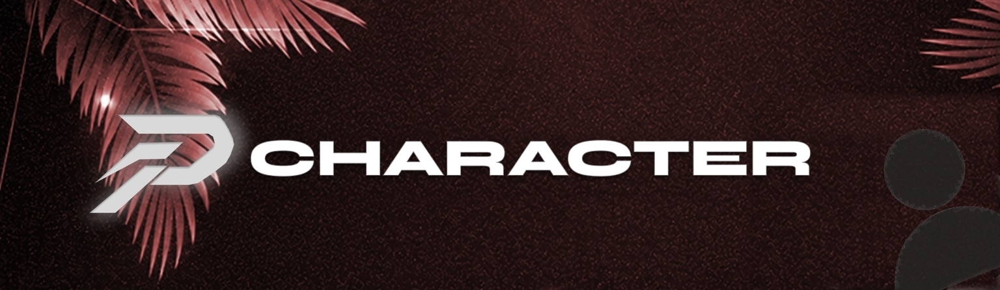
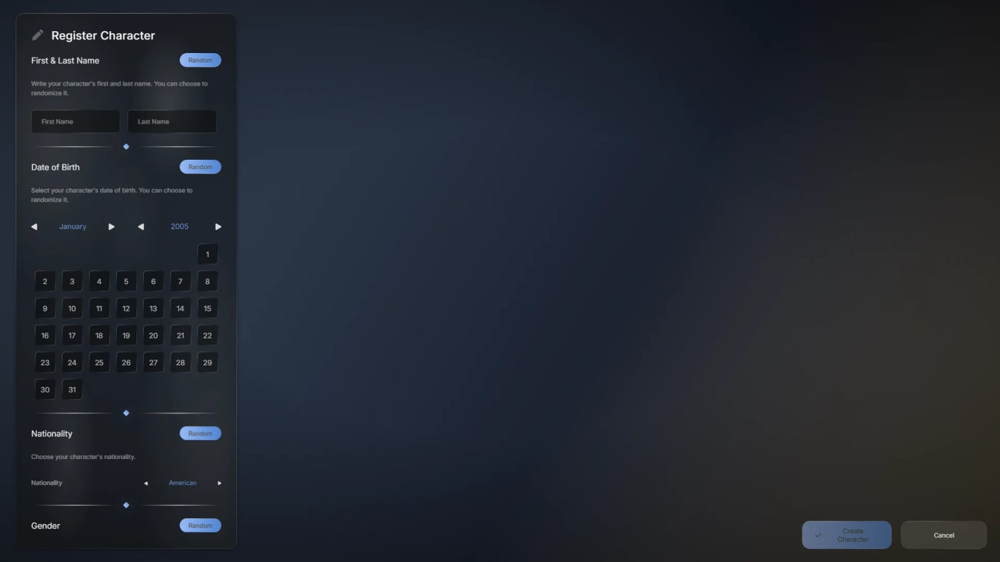
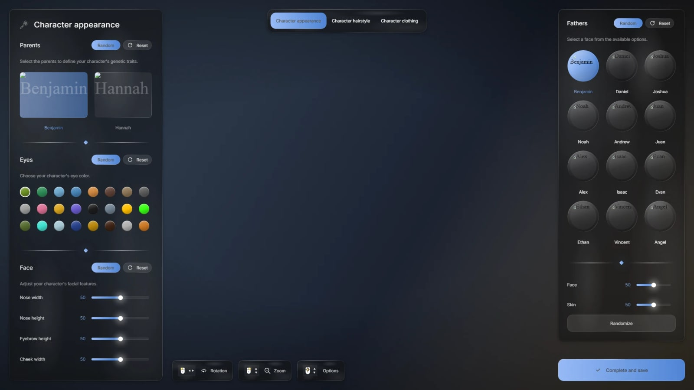

# PULSE-CHARACTER

`pulsestore-identity + pulsestore-charcreator`

**Identity first, then appearance: a registration form and a full character creator.**

 %20%7C%20ESX%20%7C%20QBCore%20%7C%20standalone-1f1f1f?style=for-the-badge) 

[**Get it on Discord**](https://discord.gg/czRymmEfuS) &nbsp;•&nbsp; [**All Pulse Store products**](https://github.com/amiculap/pulse-portfolio)

> 🔒 This page is a **showcase**. The source code is private and is delivered only after purchase.

---

## Overview

PULSE-CHARACTER is a complete character system made of two resources, `pulsestore-identity` and `pulsestore-charcreator`. Players first register their identity, then build their appearance in a modern liquid-glass interface.

## Preview

  
  

## Highlights

- 📝 **Registration form** — Name, date of birth, nationality and gender.
- 🧬 **Full creator** — Parents and face blending, skin, eyes, face features.
- 🎥 **Camera controls** — Rotation and zoom, with mouse controls on screen.
- 🌍 **9 languages** — Arabic, German, English, Spanish, French and more.

## Features

### Identity

- Complete character system: identity first, then appearance
- Registration form: first name, last name, date of birth, nationality, gender
- Calendar date picker, Random and Reset buttons on every section
- Configurable nationalities, age range and language

### Character creator

- Full character creator: parents and face blending, skin, eye color, detailed face features
- Hair and clothing tabs
- Camera with rotation and zoom, mouse controls shown on screen

### Framework & data

- Compatible with **vRP** (through a bridge), **ESX**, **QBCore** and standalone
- Identity and skin saved in the database (**MongoDB** or **oxmysql**) and loaded automatically

### Interface & extras

- Modern liquid-glass interface with configurable color theme
- Optional background music
- Multi-language: Arabic, German, English, Spanish, French, Croatian, Portuguese, Russian and Romanian

### Setup

- Easy to configure and customize
- Support included after purchase

## Compatibility

| | |
| :-- | :-- |
| **Frameworks** | vRP (through a bridge) · ESX · QBCore · standalone |
| **Databases** | MongoDB · oxmysql |
| **Languages** | Arabic · German · English · Spanish · French · Croatian · Portuguese · Russian · Romanian |

## What you get

- The complete resource, tested and fully functional
- Support after purchase through the official ticket system
- Free updates for bug fixes
- A license for your server / community

## Get it

**Price: 15€**

1. Join the [Pulse Store Discord](https://discord.gg/czRymmEfuS)
2. Open a ticket in **#tickets**
3. Tell us what you need and get the details

Payments: bank transfer, Revolut, LTC, Paysafe.

---

[← Back to the Pulse Store portfolio](https://github.com/amiculap/pulse-portfolio) &nbsp;•&nbsp; © 2026 Pulse Store — all rights reserved. See [LICENSE](LICENSE).

